# nano_diffusion

<p align="center">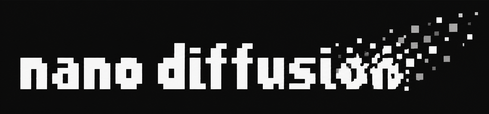</p>

From 1000-step DDPM to 1-step generators: clean, minimal PyTorch implementations of diffusion and flow models  

Blog post: [From 1000 Steps to 1: Building Diffusion and Flow Models from Scratch](https://liqq010.github.io/posts/nano-diffusion/)  

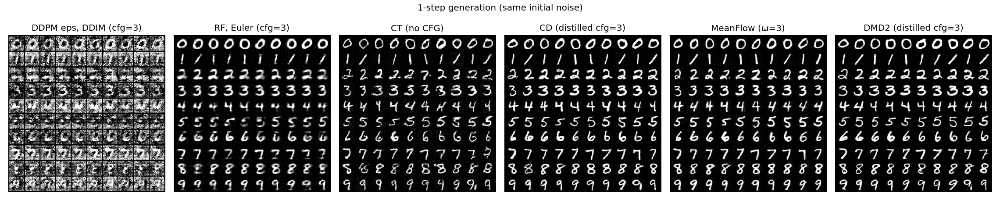
*One-step generation on MNIST using different training objectives.*


### 0. Why this repo?

There is a lot between *"train a model to remove noise"* and *"generate an image in one step."* The goal here is to make that progression easy to follow in small but complete code, without hiding the interesting parts inside a large framework.

- **Read the actual algorithms.** Minimal implementations of diffusion, flow matching, distillation, and sampling in standalone Python files.
- **Compare approaches side by side.** A shared MNIST setup and small DiT backbone make it easier to inspect differences in objectives and samplers.
- **Learn from experiments that went wrong.** Timestep grids, prediction parameterizations, time embeddings, and JVP memory usage can change the outcome dramatically.


### 1. what's covered
 - DDPM with eps / x0 / v-prediction 
 - DDIM / DPM-Solver-2 / DPM++ / UniPC
 - Rectified Flow  
 - classifier-free guidance
 - improvements, cosine schedule, trailing, logit-normal, timestep shift
 - Consistency Models (CT / CD)
 - MeanFlow
 - DMD2 distill 
 - LoRA finetune  
  

```
.
├── LICENSE
├── src
│   ├── dit.py                      # DiT backbone
│   ├── ddpm.py                     # DDPM (eps / x0 / v), DDPM / DDIM / DPM-Solver-2 / DPM++(2M) / UniPC samplers
│   ├── rf.py                       # Rectified Flow, Euler / Heun samplers
│   ├── cm.py                       # Consistency Models, CT (iCT) / CD
│   ├── meanflow.py                 # MeanFlow
│   ├── dmd.py                      # DMD2, distribution matching + GAN losses
│   ├── lora.py                     # LoRA layers
│   └── mnist_dataset.py            # MNIST dataset from HF parquet, scaled to [-1, 1]
├── scripts
│   ├── create_mnist_outlined.py    # Synthetic outlined MNIST for LoRA finetune
│   ├── ddpm_train_mnist.py         # Train DDPM (eps / x0 / v)
│   ├── ddpm_test_mnist.py          # Sample with DDPM / DDIM / DPM-Solver-2 / DPM++ / UniPC
│   ├── rf_train_mnist.py           # Train Rectified Flow (teacher / base model for CD, DMD2, LoRA)
│   ├── rf_test_mnist.py            # Sample with Euler / Heun, w/ and w/o CFG
│   ├── ct_train_mnist.py           # Consistency Training (iCT)
│   ├── ct_test_mnist.py
│   ├── cd_train_mnist.py           # Consistency Distillation from the RF teacher
│   ├── cd_test_mnist.py
│   ├── meanflow_train_mnist.py     # Train MeanFlow
│   ├── meanflow_test_mnist.py
│   ├── dmd2_train_mnist.py         # DMD2 one-step distillation from the RF teacher
│   ├── dmd2_test_mnist.py
│   ├── rf_lora_train_mnist.py      # LoRA / full finetune of RF on outlined MNIST
│   └── rf_lora_test_mnist.py
├── figs                            # Figures used in this README
└── README.md
```

### 2. how to run: 
```bash
# get mnist dataset
git clone https://huggingface.co/datasets/ylecun/mnist data/mnist   
# create synthetic outlined mnist for LoRA
python scripts/create_mnist_outlined.py  
# train / generate 
PYTHONPATH=src python scripts/rf_train_mnist.py  
PYTHONPATH=src python scripts/rf_test_mnist.py 
```

### 3. ablation studies 
experiment settings: DiT (28x28 input, patch 2, hidden 256, depth 8, 16 heads, 9.79M params)  

#### 3.1 visualization of linear vs cosine noise schedule
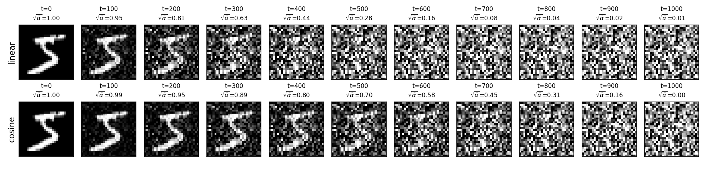  

#### 3.2 DDPM eps / x0 / v-prediction  
training loss curves  

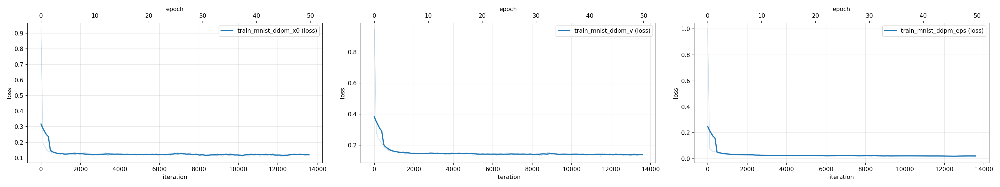  

samples generated during training  

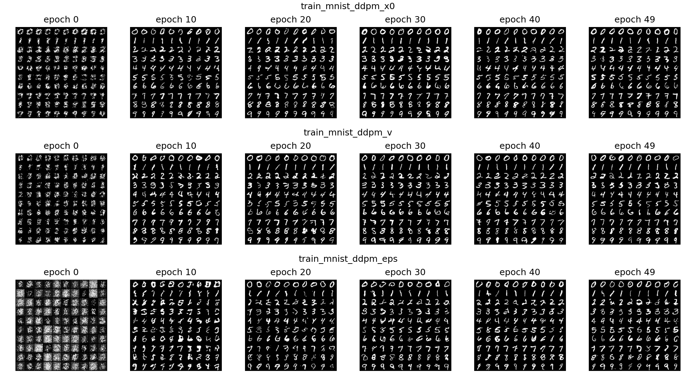  

comparison of sampling solvers:  DDIM / DPM++ / UniPC  

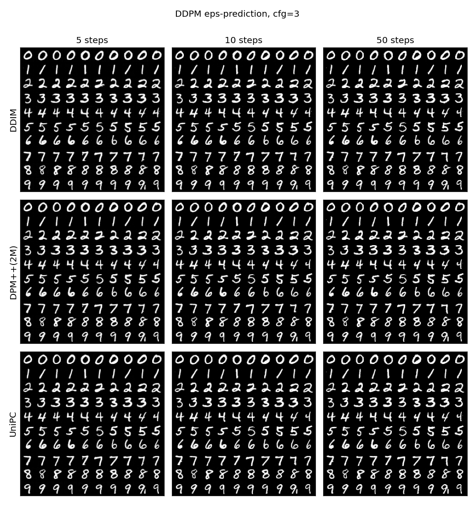    

#### 3.3 Rectified Flow  
comparison between Euler and Heun   

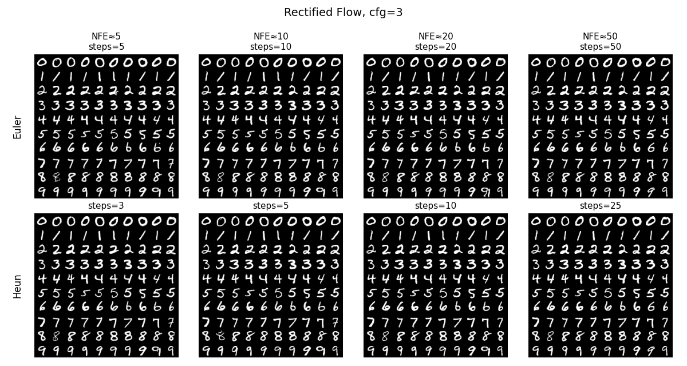

#### 3.4 Rectified Flow w/o CFG  
comparison between samples generated w/o classifier-free guidance   

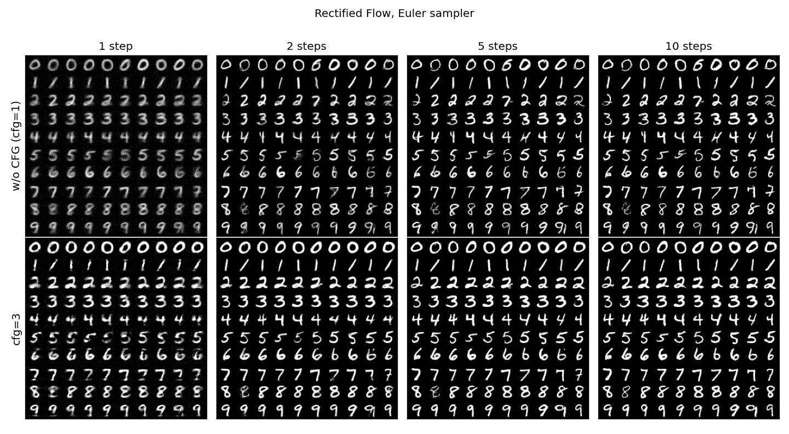

#### 3.5 Consistency Models, CT (iCT) vs CD  
comparison between consistency training (CT) and consistency distillation (CD)  

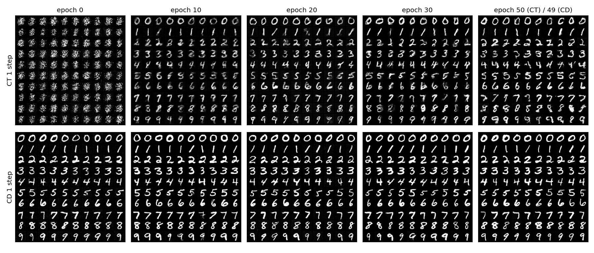

#### 3.6 MeanFlow
samples generated during training  

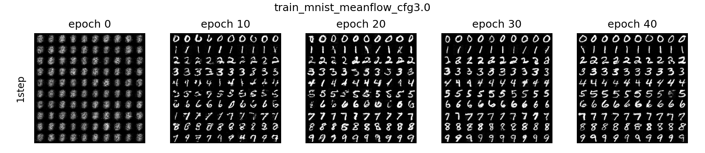

#### 3.7 DMD2 distillation
one-step generator distilled from the RF teacher (cfg=3) with distribution matching + GAN loss, TTUR 5:1, trained for 20 epochs  
training metrics monitored:  
- grad_norm: norm of the distribution matching gradient (x0_fake - x0_real) / w  
- loss_fake: flow matching loss of the fake score on generator samples  
- lag: denoise error of the fake score right after a generator update / after 5 fake updates (≈1 means the fake score keeps up)  
- fake / teacher: denoise error of fake score vs teacher on generator samples (<1 means the fake score has fitted the generator distribution)  
- p_real / p_fake, loss_d / loss_g_gan: discriminator outputs and GAN losses  

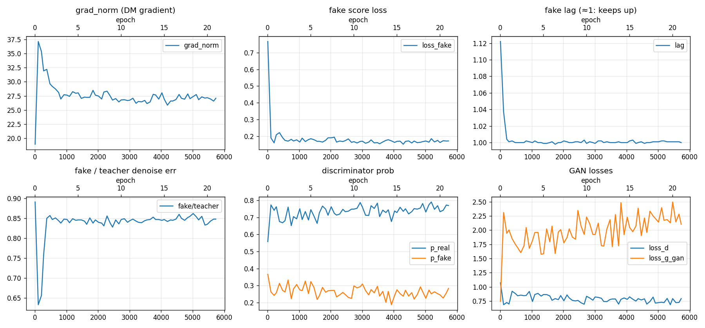

#### 3.8 1-step generation by DDIM / RF / CT / CD / MeanFlow / DMD2   
  

#### 3.9 LoRA finetune
four experiment settings, r=1(0.33%), r=4(1.34%), r=16(5.36%), full(99.49%)  

training loss curve  

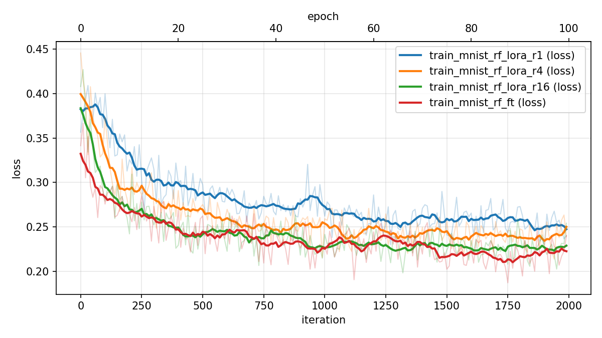

samples generated during LoRA finetune. synthetic outlined MNIST as LoRA finetune dataset     

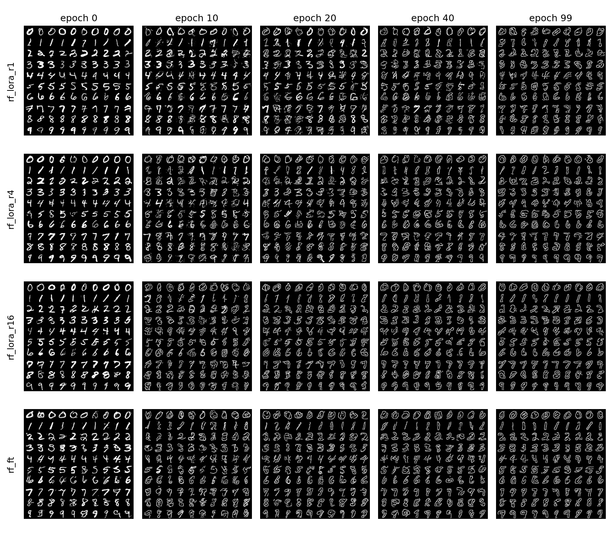

comparison between LoRA finetune and full parameter finetune  

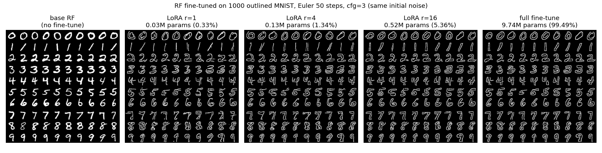  

### 4. pitfalls
- **MeanFlow time scale**: feeding `t * 1000` (as in RF) into the sinusoidal embedding amplifies du/dt by ~1000x (∂u/∂(t-r) measured 14–43 vs |v|≈1.4), the JVP target is dominated by it and training diverges (blurry, wrong-class 1-step samples). Feed t and t-r in [0, 1] as the official implementation does.
- **MeanFlow JVP memory**: default SDPA kernels do not support forward-mode AD, use the MATH backend for the JVP. Computing the JVP with autograd also stores the tangent graph (~53GB at batch 256); since the target is stop-grad, compute the JVP under `no_grad` and get u from a separate normal forward (~12GB).
- **CT time distribution**: RF's logit-normal(0, 1) puts only ~0.16% of samples at t ≥ 0.95; CT collapsed around epoch 40 (after the N 40→80 switch) in repeated runs. iCT's lognormal (P_mean=-1.1, P_std=2.0, ~2.2% at t ≥ 0.95) did not collapse.
- **DDPM few-step sampling grid**: `linspace(999, 0, steps)` wastes the last network call at t=0, so 2 steps ≈ 1 step. Use the trailing grid `linspace(999, 0, steps + 1)[:-1]`. At 1–2 steps DPM++(2M) and UniPC are identical to DDIM.
- **eps-prediction at 1 step**: x0 = (x_t - √(1-ᾱ)·ε̂) / √ᾱ with √ᾱ_999 ≈ 0.0064 amplifies the ε error ~157x, so 1-step DDIM with eps-prediction is pure noise while x0 / v give blurry means.

### 5. citations    
DDPM [Denoising Diffusion Probabilistic Models](https://arxiv.org/abs/2006.11239)  
Rectified Flow [Flow Straight and Fast: Learning to Generate and Transfer Data with Rectified Flow](https://arxiv.org/abs/2209.03003)  
DDIM [Denoising Diffusion Implicit Models](https://arxiv.org/abs/2010.02502)  
DPM-Solver-2 [DPM-Solver: A Fast ODE Solver for Diffusion Probabilistic Model Sampling in Around 10 Steps](https://arxiv.org/abs/2206.00927)  
DPM++ [DPM-Solver++: Fast Solver for Guided Sampling of Diffusion Probabilistic Models](https://arxiv.org/abs/2211.01095)  
UniPC [UniPC: A Unified Predictor-Corrector Framework for Fast Sampling of Diffusion Models](https://arxiv.org/abs/2302.04867)  
Heun [Elucidating the Design Space of Diffusion-Based Generative Models](https://arxiv.org/abs/2206.00364)  
v-prediction [Progressive Distillation for Fast Sampling of Diffusion Models](https://arxiv.org/abs/2202.00512)  
cosine schedule [Improved Denoising Diffusion Probabilistic Models](https://arxiv.org/abs/2102.09672)  
trailing [Common Diffusion Noise Schedules and Sample Steps are Flawed](https://arxiv.org/abs/2305.08891)  
CFG [Classifier-Free Diffusion Guidance](https://arxiv.org/abs/2207.12598)  
logit-normal, timestep shift [Scaling Rectified Flow Transformers for High-Resolution Image Synthesis](https://arxiv.org/abs/2403.03206)  
Consistency Models [Consistency Models](https://arxiv.org/abs/2303.01469), [Improved Techniques for Training Consistency Models](https://arxiv.org/abs/2310.14189)  
MeanFlow [Mean Flows for One-step Generative Modeling](https://arxiv.org/abs/2505.13447)  
DMD [One-step Diffusion with Distribution Matching Distillation](https://arxiv.org/abs/2311.18828)  
DMD2 [Improved Distribution Matching Distillation for Fast Image Synthesis](https://arxiv.org/abs/2405.14867)  
DiT [Scalable Diffusion Models with Transformers](https://arxiv.org/abs/2212.09748)  
LoRA finetune [LoRA: Low-Rank Adaptation of Large Language Models](https://arxiv.org/abs/2106.09685)  

### License
MIT, see [LICENSE](LICENSE).
